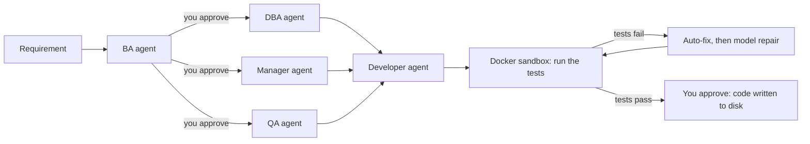

# AI-Agents[README.md](https://github.com/user-attachments/files/35396504/README.md)
# AISEW: AI Software Engineering Workforce (Python)

A team of AI agents that turns a plain-English requirement into a **designed, planned, tested backend**,
with a human approval gate between every stage, an audit trail, and generated code that is only ever
executed inside a locked-down Docker container.

It runs fully **locally** on [Ollama](https://ollama.com) models. No cloud account, no data leaves your machine.



A 5-minute demo walkthrough, with talking points and likely questions, is in [DEMO.md](DEMO.md).

## What each agent produces

| Agent | Input | Output |
|---|---|---|
| **BA** | Your requirement (+ your answers to its questions) | User stories, business rules, testable acceptance criteria, open questions |
| **DBA** | Approved BA output | Tables, columns, foreign keys, indexes |
| **Manager** | Approved BA output | Ordered task plan with dependencies and effort |
| **QA** | Approved BA output | Test cases that trace back to acceptance criteria |
| **Developer** | All of the above | Python / FastAPI / SQLAlchemy code and pytest tests, tested in a sandbox |

DBA, Manager and QA run **in parallel** as soon as the BA is approved. The Developer starts when all three are approved.

## Design decisions worth reading

**Humans stay in control.** Every stage ends in an artifact you approve, answer questions on, or correct with
feedback. Nothing is written to disk until you approve the Developer's result. Approvals, answers and
failures are all recorded in an audit log.

**Agents ask instead of guessing.** Each agent has a rule never to invent facts. Missing information becomes
an open question, and a *blocking* question stops the pipeline until you answer. Your answers are passed to every
later agent as confirmed facts, so nothing is asked twice.

**Small local models are made reliable with checks, not hope.** Every output is validated against a schema, then
against quality rules that a model cannot talk its way around, for example:
- numbers that were never in the requirement are rejected (no invented "3 business days"),
- time rules must say what they are measured from ("at least 24 hours *before* the booking starts"),
- the database design must be able to store what the rules talk about (refunds, cancellation, a start time),
- the plan may not put testing before implementation,
- every acceptance criterion must be covered by a test case,
- generated Python must parse, and contain no TODOs or placeholders.

A failed check sends the exact problem back to the agent for one retry. If it still fails, the problem is shown
to you (`quality_issues`) and the confidence is capped. It is never hidden.

**Code is generated in two steps.** Small models cannot write code inside a JSON string, so the Developer first
plans the files, then writes **one file per model call** as plain text, checking and retrying each file on its own.

**A test-and-fix loop that tries free fixes first.** The generated tests run in Docker. On failure AISEW first
applies rule-based fixes (a missing import, a misspelled `Column` argument) which cost no model call, and only then
asks the model to rewrite the files named in the traceback.

**Safe by construction.**
- The sandbox container has no network, 768 MB of memory, 1 CPU, no capabilities, a read-only root filesystem,
  a process limit and a time limit. Generated code never runs on your machine.
- The workspace writer accepts only relative paths of known text file types. Anything with `..`, an absolute path,
  a drive letter, an executable type or an oversized file is skipped and logged, and the rest is still written.
- All long work runs in the background with a timeout and an output limit on every model call, so a stuck model
  cannot hang the system.

## Quick start (Windows PowerShell; macOS and Linux are similar)

Requirements: Python 3.11+, [Ollama](https://ollama.com), and (for the test loop) Docker Desktop.

```powershell
git clone https://github.com/AnilGudla-18/AI-Agents.git
cd AI-Agents/aisew-python
python -m venv .venv
.venv\Scripts\activate
pip install -e ".[dev]"

ollama pull qwen2.5-coder:7b          # or qwen2.5-coder:3b / llama3.2 on a small PC
python -m pytest                      # 191 tests, no Ollama or Docker needed

$env:AISEW_MODEL="qwen2.5-coder:7b"
uvicorn aisew.api.main:app --reload --reload-dir src
```

Open <http://localhost:8000/docs>. Optional, once: start Docker Desktop, then call `GET /sandbox` and
`POST /sandbox/build`.

## Using it

| Step | Call |
|---|---|
| 1. Submit a requirement | `POST /requirements` `{"text": "Customers should be able to cancel a booking and get a refund"}` |
| 2. Watch progress | `GET /requirements/{id}`: see `running`, `awaiting` (what to do next), `needs_retry` |
| 3. Answer the agent's questions | `POST /artifacts/{id}/reply` |
| 4. Correct any pending result | `POST /artifacts/{id}/feedback` `{"feedback": "..."}` |
| 5. Approve | `POST /artifacts/{id}/approve`: BA first, then DBA/Manager/QA, then the Developer |
| 6. Read the generated code | `GET /artifacts/{id}/code` |
| 7. Re-run the tests of a pending Developer result | `POST /artifacts/{id}/retest` |

After the Developer is approved, the response contains the `workspace` folder holding your code.

## Configuration

| Environment variable | Default | Meaning |
|---|---|---|
| `AISEW_MODEL` | `llama3.1:8b` | Ollama model used by every agent |
| `AISEW_NUM_CTX` | `8192` | Context window. Ollama's own default is small and silently cuts prompts |
| `AISEW_MAX_TOKENS` | `6000` | Longest answer one model call may write |
| `AISEW_TIMEOUT` | `900` | Seconds one model call may take |
| `AISEW_MAX_PARALLEL` | `3` | Agents that may run at the same time (use `1` on a weak PC) |
| `AISEW_SANDBOX` | `docker` | `docker` or `off` |
| `AISEW_FIX_ROUNDS` | `2` | Model repair rounds after a failed test run |
| `AISEW_TEST_TIMEOUT` | `120` | Seconds the sandbox may run the tests |
| `AISEW_BACKGROUND` | `1` | `0` makes requests wait for the agents (used by tests) |
| `AISEW_WORKSPACE_DIR` | `workspaces` | Where approved code is written |
| `AISEW_DATABASE_URL` | `sqlite:///aisew.db` | Any SQLAlchemy URL |
| `OLLAMA_HOST` | `http://localhost:11434` | Ollama server |

## Project layout

```
src/aisew/
  agents/          BaseAgent + BA, DBA, Manager, QA, Developer, and the rule-based autofix
  domain/          output schemas shared by every agent
  llm/             Ollama client, fake client for tests
  orchestration/   pipeline: stage dependencies, parallel runs, approval, test-and-fix loop
  persistence/     SQLAlchemy models (artifacts, clarifications, audit log, usage)
  sandbox/         Docker test runner
  workspace/       the safe file writer
  api/             FastAPI app
tests/             191 tests (agents, pipeline, sandbox, safety, background runs)
```

The stage order lives in one table (`PIPELINE` in `orchestration/pipeline.py`). Adding an agent means writing
its schema and rules and adding one line there.

## Honest limitations

- The Developer targets **Python / FastAPI / SQLAlchemy** backends only.
- With a **small local model** (3B), the generated code often needs a fix. The checks, the test loop and the
  approval gates exist because of this, and they surface problems instead of hiding them. A 7B+ model or a
  hosted model gives noticeably better code.
- Passing tests do not prove the logic is right: the same model writes the code and the tests. Read the code
  against your business rules before approving.
- The API has **no authentication**. It is built for local use. Do not expose it to a network.
- The Docker test runner is covered by unit tests against a fake `docker` command, and by manual runs on Windows.
  It has not been run through a CI pipeline.

## Roadmap

Code Review, Security and DevOps agents; a "reopen" action for approved results; an optional hosted model for the
Developer stage; support for more languages.

## Tests

```powershell
python -m pytest
```

191 tests, none of which need Ollama or Docker. They cover each agent's quality rules, the pipeline (ordering,
parallel runs, failures, retries), the safe file writer (path traversal and more), the Docker command line, the
test-and-fix loop, and the background-run behaviour.
